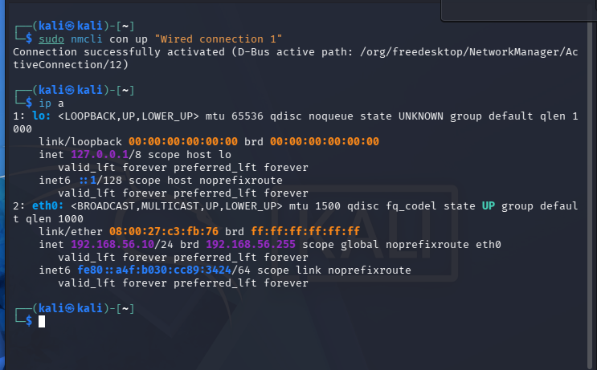
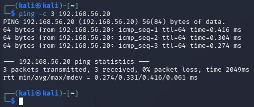
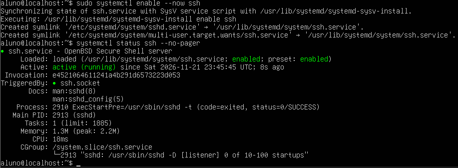
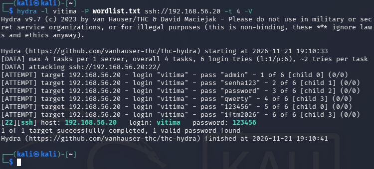
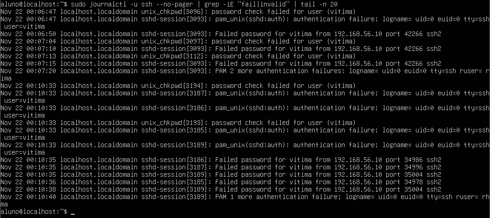
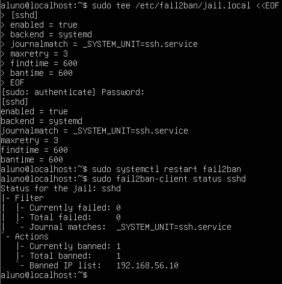
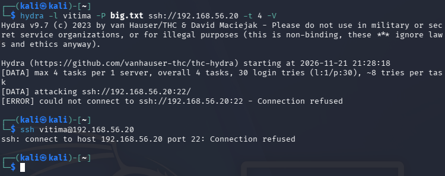
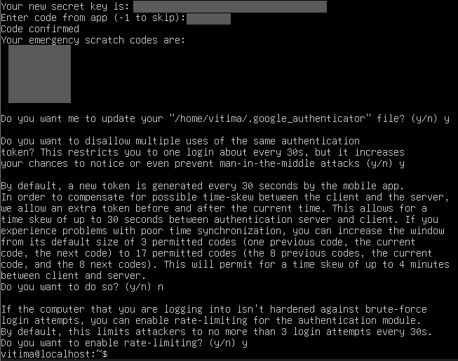
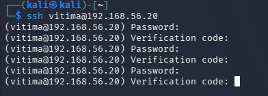
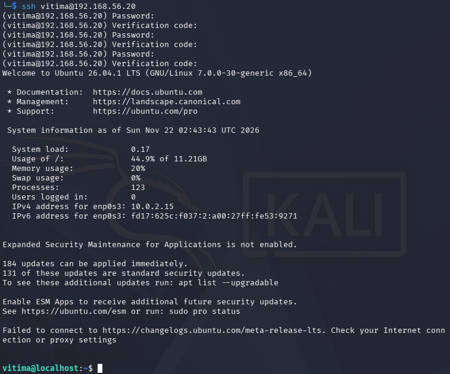

# Prova 04: Simulação de Ataque de Força Bruta e Implementação de Mecanismos de Defesa

**Disciplina:** Segurança da Informação, IFTM
**Aluno:** Augusto Alex Caixeta Silva
**Professor:** Junio Moreira (`junio-moreira-dev`)
**Data:** novembro de 2026

> [!WARNING]
> **Aviso ético.** Todo o procedimento foi executado em ambiente de laboratório isolado, montado no VirtualBox, usando uma Rede Interna (`labnet`) sem contato com a internet ou com a rede física. As duas máquinas virtuais são de minha propriedade e foram criadas apenas para fins didáticos. Nenhum sistema de terceiros foi alvo. Reproduzir estas técnicas contra sistemas de terceiros sem autorização configura crime, conforme a Lei nº 12.737/2012 (Lei Carolina Dieckmann).

---

## 1. Objetivo

Este trabalho demonstra a fragilidade de uma senha fraca diante de um ataque automatizado de **força bruta** contra o serviço SSH e, em seguida, aplica e valida duas defesas que impedem esse ataque.

1. **Fail2ban**, que bloqueia o IP de origem após um número limitado de tentativas falhas.
2. **Autenticação de dois fatores (2FA com TOTP)**, que torna a senha, sozinha, insuficiente para entrar.

---

## 2. Ambiente e Topologia

O laboratório tem duas máquinas virtuais. A rede do ataque é uma **Rede Interna chamada `labnet`** (`192.168.56.0/24`), isolada da internet. A máquina alvo tem ainda uma segunda placa em NAT, usada apenas para baixar os pacotes de defesa. Durante os ataques, a comunicação acontece pela `labnet`.

| Papel | Sistema | IP na labnet | Interface | Ferramentas |
|-------|---------|--------------|-----------|-------------|
| Atacante | Kali Linux 2026.3 | `192.168.56.10` | `eth0` | Hydra |
| Alvo | Ubuntu Server 26.04.1 LTS | `192.168.56.20` | `enp0s8` | OpenSSH, Fail2ban, Google Authenticator |

A máquina alvo usa a placa `enp0s3` em NAT para internet e a placa `enp0s8` na `labnet` com o IP `192.168.56.20`.

```
        Rede Interna "labnet" (192.168.56.0/24), ISOLADA

   [ Kali Linux ]                               [ Ubuntu Server ]
     Atacante                                        Alvo
   192.168.56.10  ===== SSH (porta 22) =====>   192.168.56.20
      eth0                                          enp0s8
                                                      |
                                                    enp0s3 (NAT, apenas
                                                    para instalar pacotes)
```

Configuração de rede do atacante (Kali):

```bash
sudo nmcli con mod "Wired connection 1" ipv4.method manual ipv4.addresses 192.168.56.10/24
sudo nmcli con mod "Wired connection 1" ipv4.dad-timeout 0
sudo nmcli con up "Wired connection 1"
```

Configuração de rede do alvo (Ubuntu), no arquivo `/etc/netplan/00-installer-config.yaml`:

```yaml
network:
  version: 2
  ethernets:
    enp0s3:
      dhcp4: true
    enp0s8:
      addresses:
        - 192.168.56.20/24
```

O comando `ip a` no Kali confirma o IP `192.168.56.10`.



O `ping -c 3 192.168.56.20` feito do Kali, com 0% de perda, prova a conectividade na rede isolada.



---

## 3. Etapa 1: Demonstração do Ataque

### 3.1 Serviço alvo e usuário vulnerável (no Ubuntu)

Instalação do servidor SSH e criação de um usuário com senha fraca proposital.

```bash
sudo apt install -y openssh-server
sudo systemctl enable --now ssh
sudo useradd -m -s /bin/bash vitima
sudo passwd vitima
```

A senha definida para o usuário `vitima` foi `123456`.

Verificação de que o SSH aceita login por senha:

```bash
sudo sshd -T | grep passwordauthentication
```

O resultado foi `passwordauthentication yes`.



### 3.2 Wordlist

O arquivo [`wordlist.txt`](./wordlist.txt), incluído neste repositório, tem a senha do alvo no meio de senhas comuns.

```
admin
senha123
password
qwerty
123456
iftm2026
```

### 3.3 Ataque com Hydra (no Kali)

```bash
hydra -l vitima -P wordlist.txt ssh://192.168.56.20 -t 4 -V
```

Os parâmetros significam: `-l` usuário alvo, `-P` arquivo de senhas, `-t 4` quatro tarefas em paralelo e `-V` exibe cada tentativa. O Hydra descobriu a senha.

```
[22][ssh] host: 192.168.56.20   login: vitima   password: 123456
1 of 1 target successfully completed, 1 valid password found
```



### 3.4 Evidência nos logs do alvo (no Ubuntu)

```bash
sudo journalctl -u ssh --no-pager -g "Failed password"
```

As várias linhas `Failed password for vitima from 192.168.56.10` mostram, no servidor, o ataque automatizado vindo do Kali.



**Conclusão da Etapa 1:** sem defesa, a senha fraca foi quebrada em poucos segundos.

---

## 4. Etapa 2: Defesas

### 4.1 Defesa A: Bloqueio por tentativas com Fail2ban

```bash
sudo apt install -y fail2ban
```

Configuração no arquivo `/etc/fail2ban/jail.local`:

```ini
[sshd]
enabled = true
backend = systemd
journalmatch = _SYSTEMD_UNIT=ssh.service
maxretry = 3
findtime = 600
bantime = 600
```

> [!NOTE]
> O OpenSSH do Ubuntu 26.04 registra as falhas de login pelo processo `sshd-session`, e não mais pelo processo `sshd`. O filtro padrão do Fail2ban procura por `sshd` e, por isso, não detectava as tentativas. A linha `journalmatch = _SYSTEMD_UNIT=ssh.service` resolve o problema, pois faz o Fail2ban ler todos os eventos do serviço SSH, incluindo os do `sshd-session`.

Aplicar e conferir:

```bash
sudo systemctl restart fail2ban
sudo fail2ban-client status sshd
```

**Validação.** Ao repetir o ataque, depois de 3 tentativas o IP do Kali foi bloqueado.

No Ubuntu, o status mostrou `Currently banned: 1` e o IP `192.168.56.10` na lista de banidos.

```bash
sudo fail2ban-client status sshd
```



No Kali, tanto o Hydra quanto o `ssh` passaram a receber `Connection refused`.

```bash
hydra -l vitima -P big.txt ssh://192.168.56.20 -t 4 -V
ssh vitima@192.168.56.20
```



### 4.2 Defesa B: Autenticação de dois fatores (2FA com TOTP)

Instalação do módulo e geração do segredo para o usuário `vitima`. O QR Code foi lido por um aplicativo autenticador no celular.

```bash
sudo apt install -y libpam-google-authenticator
su - vitima
google-authenticator
exit
```

Na execução do `google-authenticator` foram escolhidos tokens baseados em tempo e as opções de segurança recomendadas. A secret key e os códigos de emergência foram cobertos no print abaixo.



Para exigir o código no SSH, foi acrescentada a linha abaixo ao final do arquivo `/etc/pam.d/sshd`:

```
auth required pam_google_authenticator.so nullok
```

E foi criado o arquivo `/etc/ssh/sshd_config.d/2fa.conf` com o conteúdo:

```
KbdInteractiveAuthentication yes
UsePAM yes
AuthenticationMethods keyboard-interactive
```

Aplicar:

```bash
sudo systemctl restart ssh
```

**Validação.** O SSH passou a pedir senha e também o código do aplicativo.

No caso do atacante, com a senha certa (`123456`) mas um código inválido como `000000`, o acesso foi negado.

```bash
ssh vitima@192.168.56.20
```



No caso do usuário legítimo, com a senha e o código de 6 dígitos do aplicativo, o login funcionou.

```bash
ssh vitima@192.168.56.20
```



---

## 5. Conclusão

| Cenário | Resultado do ataque |
|---------|---------------------|
| Sem defesa | Senha quebrada em segundos |
| Com Fail2ban | Atacante bloqueado após 3 tentativas |
| Com Fail2ban e 2FA | Ataque inviável mesmo com a senha correta |

O bloqueio por tentativas do Fail2ban reduz muito a viabilidade do ataque automatizado. A autenticação de dois fatores torna a senha, sozinha, insuficiente para entrar. As duas defesas juntas inviabilizam o ataque de força bruta, que era o objetivo da atividade.

---

## 6. Artefatos e Submissão

- **Evidências (prints das etapas):** pasta [`evidencias`](./evidencias)
- **Wordlist utilizada no ataque:** [`wordlist.txt`](./wordlist.txt)
- **Link de submissão no Moodle:** <https://ava.iftm.edu.br/mod/assign/view.php?id=221615>

```
.
├── README.md
├── wordlist.txt
└── evidencias/
    ├── 01-ip-kali.png
    ├── 02-ping-labnet.png
    ├── 03-ssh-ativo-usuario.png
    ├── 04-hydra-sucesso.png
    ├── 05-logs-failed-password.png
    ├── 06-fail2ban-banido.png
    ├── 07-ataque-bloqueado.png
    ├── 08-2fa-qrcode.png
    ├── 09-2fa-nega-atacante.png
    └── 10-2fa-login-legitimo.png
```
